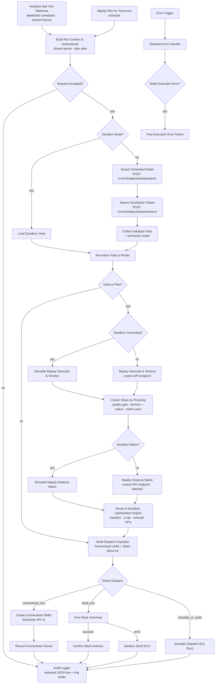

# n8n-hubspot-mapsly-territory-route-optimizer

**A field-operations dispatcher for HubSpot.** It ingests newly scheduled site-visit deals and tickets, geocodes them and resolves territories through Mapsly, clusters stops by proximity, builds optimised daily technician routes that respect skills, territories, time windows and shift hours, and pushes the schedule to Connecteam with a dispatcher summary in Slack.

Built by DH Robin · dhRobin Systems · Revenue infrastructure architecture

> **Safe by default.** The workflow ships with `SANDBOX_MODE=true` and `DRY_RUN=true`. In that state it calls no HubSpot, Mapsly, Connecteam or Slack API. The full plan is still built and audited from pinned, fictional fixtures (15 site visits, 4 technicians). Even in live mode, Connecteam shifts are created as **unpublished drafts** until you set `CONNECTEAM_PUBLISH_SHIFTS=true`.

---

## Table of Contents

1. [Why this exists](#1-why-this-exists)
2. [Architecture](#2-architecture)
3. [Repository layout](#3-repository-layout)
4. [Quick start](#4-quick-start)
5. [HubSpot & Mapsly API endpoints and scopes](#5-hubspot--mapsly-api-endpoints-and-scopes)
6. [Geocoding & clustering logic](#6-geocoding--clustering-logic)
7. [Route optimization workflow](#7-route-optimization-workflow)
8. [Connecteam & Slack payload structures](#8-connecteam--slack-payload-structures)
9. [Environment variables](#9-environment-variables)
10. [Node configuration](#10-node-configuration)
11. [Testing stages](#11-testing-stages)
12. [Security model](#12-security-model)
13. [Troubleshooting](#13-troubleshooting)
14. [Known limitations](#14-known-limitations)
15. [Disclaimer & license](#15-disclaimer--license)

---

## 1. Why this exists

When a site visit is sold or a ticket needs an on-site fix, the visit lands in HubSpot with an address and a date. From there, most field teams I work with plan the day by hand: someone eyeballs a map, guesses who is closest, and types the schedule into the field app. The usual result is technicians crossing each other's territories, high-priority visits squeezed in late, and nobody noticing that a visit needs a skill no one on shift has.

This workflow automates that planning step:

1. **Collect** every scheduled visit for the service day from HubSpot (deals and tickets).
2. **Geocode and resolve territories** through Mapsly, and reject addresses that are too vague to route.
3. **Cluster** stops by territory and proximity.
4. **Optimise** routes: skills, territories, arrival windows, shift hours, stop caps and priority.
5. **Dispatch** one Connecteam shift per visit (address, GPS and route notes), and send dispatchers a Slack summary with every unassigned visit and the reason it couldn't be placed.

---

## 2. Architecture



**Design principle: the sandbox and live paths converge before the logic.** The simulators answer in exactly the shape the live HubSpot and Mapsly calls return. *Normalize*, *Cluster*, the *Engine* and *Build Dispatch* therefore run the same code in every mode.

---

## 3. Repository layout

```text
n8n-hubspot-mapsly-territory-route-optimizer/
├── README.md        # This guide
├── workflow.json    # Importable n8n workflow (35 nodes incl. 3 sticky notes, pinned fixtures)
├── DISCLAIMER.md    # Liability limitation & open-source notice
└── LICENSE          # MIT License
```

---

## 4. Quick start

1. In n8n, go to **Workflows → Import from File** and choose `workflow.json`.
2. Leave every environment variable unset. Sandbox mode and dry run apply.
3. Select the **HubSpot Site Visit Webhook** trigger and click **Execute workflow**. It uses its pinned fixtures.
4. Compare the **Audit Logger** output with the [expected plan](#stage-1--sandbox-pinned-fixtures-no-network).
5. Open **Simulate Dispatch (Dry Run)**. You'll find the Connecteam shift arrays in `request.body`, and the Slack message in `slackMessage.blocks` (paste it into Block Kit Builder to preview).
6. In **Workflow settings → Error Workflow**, select this workflow so the Error Trigger branch handles failures.

### n8n platform prerequisites

| Setting | Why |
|---|---|
| `N8N_BLOCK_ENV_ACCESS_IN_NODE=false` | Configuration is read from `$env`. Recent n8n versions block env access by default. If access stays blocked, every Code node falls back to sandbox mode and dry run. |
| `NODE_FUNCTION_ALLOW_BUILTIN=crypto` | Constant-time webhook secret comparison and run IDs. A slower fallback exists. |
| Workflow timezone | The nightly trigger fires at 18:00 in the workflow timezone (Workflow settings, `UTC` in the export). Set it to your field team's zone. Planning times use `PLANNING_TIMEZONE`. |
| Concurrency 1 for this workflow | The dispatch ledger lives in workflow static data, which isn't transactional. Parallel re-plans of the same date could dispatch twice. |

The node versions used are Webhook v2, Schedule Trigger v1.2, Code v2, IF v2.2, Switch v3.2 and HTTP Request v4.2.

---

## 5. HubSpot & Mapsly API endpoints and scopes

### 5.1 HubSpot (read-only)

| Purpose | Endpoint | Scope |
|---|---|---|
| Scheduled site-visit deals for the plan date | `POST /crm/v3/objects/deals/search` (paginated by `after`) | `crm.objects.deals.read` |
| Scheduled site-visit tickets for the plan date | `POST /crm/v3/objects/tickets/search` | `tickets` |

Both searches filter on `site_visit_date = plan date` (a HubSpot date property, stored as midnight UTC in epoch ms) and `site_visit_status IN (scheduled, confirmed)`. The workflow never writes to HubSpot.

**Required custom properties** (create them on Deals and/or Tickets, in a "Site Visit" group):

| Internal name | Type | Notes |
|---|---|---|
| `site_visit_date` | Date picker | Service day |
| `site_visit_status` | Dropdown | `scheduled`, `confirmed`, `completed`, `cancelled` |
| `site_visit_street`, `site_visit_city`, `site_visit_state`, `site_visit_postal_code`, `site_visit_country` | Single-line text | Site address (not necessarily the company's billing address) |
| `site_visit_latitude`, `site_visit_longitude` | Number | Optional. Skips geocoding when both are set. |
| `site_visit_duration_minutes` | Number | Default `DEFAULT_VISIT_MINUTES` (60) |
| `site_visit_required_skills` | Multiple checkboxes | For example `hvac;electrical`. Must match roster skills. |
| `site_visit_window_start`, `site_visit_window_end` | Single-line text `HH:MM` | **Arrival window**: service must *start* inside it. |
| `site_visit_priority` | Dropdown | `high`, `normal`, `low` |

**HubSpot webhook setup.** Create a deal-based (and/or ticket-based) HubSpot workflow. Trigger it when `site_visit_status` is `scheduled` and `site_visit_date` is known, and add the **Send a webhook** action:

- `POST https://YOUR_N8N_HOST/webhook/hubspot-site-visit-scheduled`
- Header `x-webhook-secret: YOUR_WEBHOOK_SHARED_SECRET`
- Body containing at least `hs_object_id` and `site_visit_date`, or `{ "planDate": "YYYY-MM-DD" }`

Each call re-plans the **whole service day**, not just the one visit.

### 5.2 Mapsly: how the integration works

Mapsly's public **record API** is for creating, updating and removing records in Mapsly from an external system. It's a data-sync API, not a geocoding or routing API. Mapsly's geocoding, territory matching, driving distance/time and routing live in its **no-code automation platform**. To call that logic from outside, Mapsly lets you expose **custom API endpoints**: you build a Button with actions inside Mapsly, and Mapsly gives you a URL that runs it and returns `{ "code": …, "data": … }`.

That's why this workflow calls **two custom Mapsly endpoints that you create in your Mapsly account**, using the contracts below. I've written the contracts to match what Mapsly's automation can produce. Build them with Mapsly's geocode, territory and driving distance/time actions, or ask Mapsly support (they offer implementation help) to set them up against these contracts.

**Endpoint settings in Mapsly:**

- **Mode:** *Sync*. The response comes back on the same connection. Mapsly keeps the connection open until the session ends, which is capped at about 10 minutes by default.
- **Authentication:** *API key*, for server-to-server calls. Mapsly appends the key to the endpoint URL, so **the full URL is a secret**. Store it only in `MAPSLY_GEO_ENDPOINT_URL` / `MAPSLY_MATRIX_ENDPOINT_URL`. If your endpoint expects the key as a separate query parameter, set `MAPSLY_API_KEY` and `MAPSLY_API_KEY_PARAM`, and the workflow appends it.
- Mapsly throttles synchronous API calls (5 per second per key for its record API). Matrix batches are sent one at a time, 300 ms apart.

#### Endpoint A · Geocode & Territory (`MAPSLY_GEO_ENDPOINT_URL`)

Request (`POST`, JSON):

```json
{
  "requestId": "route_…",
  "planDate": "2026-11-17",
  "stops": [
    { "stopId": "deal:80000001", "address": "12 Fixture Lane, North Quarter, FV, 00000, Fixtureland" },
    { "stopId": "deal:80000014", "lat": 30.35, "lng": -97.76 }
  ]
}
```

Response:

```json
{
  "code": 200,
  "data": {
    "results": [
      { "stopId": "deal:80000001", "lat": 30.44, "lng": -97.72, "matchQuality": "rooftop",
        "formattedAddress": "12 Fixture Lane, North Quarter, Fixtureland",
        "territories": [ { "id": "north", "name": "North" } ] },
      { "stopId": "deal:80000014", "lat": 30.35, "lng": -97.76, "matchQuality": "provided", "territories": [] }
    ]
  }
}
```

`matchQuality` must be one of `rooftop`, `street`, `postal`, `city` or `none`. `territories` lists every Mapsly territory that contains the point. The **first one** is treated as primary for clustering.

#### Endpoint B · Distance Matrix (`MAPSLY_MATRIX_ENDPOINT_URL`)

To stay well inside Mapsly's execution limits, the workflow asks for a **sparse** set of legs instead of a full N×N matrix: each stop's `MATRIX_NEIGHBORS` (8) nearest stops in both directions, plus start/end legs for every technician with the right skills.

Request:

```json
{
  "requestId": "route_…:0",
  "profile": "driving",
  "points": [ { "id": "deal:80000001", "lat": 30.44, "lng": -97.72 }, { "id": "tech:tech-01:start", "lat": 30.45, "lng": -97.70 } ],
  "pairs": [ [ "tech:tech-01:start", "deal:80000001" ], [ "deal:80000001", "deal:80000002" ] ]
}
```

Response:

```json
{
  "code": 200,
  "data": {
    "legs": [ { "from": "tech:tech-01:start", "to": "deal:80000001", "durationSec": 570, "distanceMeters": 7100 } ]
  }
}
```

Pairs are batched at `MAPSLY_MAX_PAIRS_PER_CALL` (300) per request. **Missing legs are estimated** from straight-line distance (detour factor plus distance-banded speeds). Estimates are counted and raised as an alert in live mode, so you know when Mapsly didn't answer for a pair. An empty `pairs` array must return `{ "code": 200, "data": { "legs": [] } }`.

### 5.3 Connecteam & Slack

| Purpose | Endpoint | Auth |
|---|---|---|
| Create shifts (1–500 per request) | `POST https://api.connecteam.com/scheduler/v1/schedulers/{schedulerId}/shifts?notifyUsers=…` | `X-API-KEY: YOUR_CONNECTEAM_API_TOKEN` |
| Dispatcher summary | Slack incoming webhook | Secret URL |

---

## 6. Geocoding & clustering logic

### 6.1 Normalisation

- **Plannable statuses:** `scheduled`, `confirmed` or blank. Other statuses become `status_not_plannable`.
- **Address:** street, city, state, postal code and country are joined. If the address is missing and there are no coordinates, the visit becomes `address_missing`.
- **Windows:** `HH:MM` local times in `PLANNING_TIMEZONE`. If a window is invalid or inverted, the default window (`08:00–17:00`) is used.
- **Skills:** values split on `;` or `,` and lowercased.
- `MAX_STOPS_PER_RUN` (200) caps one plan.

### 6.2 Geocode quality gate

| `matchQuality` | Rank | Default result |
|---|---|---|
| `provided` (lat/lng on the record) | 5 | ✔︎ |
| `rooftop` | 4 | ✔︎ |
| `street` | 3 | ✔︎ (`MIN_GEOCODE_QUALITY=street`) |
| `postal` | 2 | ✘ `geocode_low_quality` |
| `city` / `none` | 1 / 0 | ✘ `geocode_low_quality` |

A postal-code centroid can be kilometres away from the real site, and routing a technician there wastes the trip. Low-quality matches are therefore left for a dispatcher to fix. If the Mapsly endpoint itself fails, every visit without coordinates becomes `geocode_service_unavailable`, and the plan raises a **critical** alert.

### 6.3 Clustering

1. **Group by primary territory.** Visits outside every territory go into an `__none__` group.
2. **Greedy radius clustering** inside each group: take the first unclustered stop (sorted by latitude and longitude) as a seed, and pull in every stop within `CLUSTER_RADIUS_KM` (15 km). Repeat until the group is empty.
3. Each stop gets a `clusterId`. Clusters are used for matrix sparsity, for a small **affinity bonus** in the optimiser (it prefers keeping a cluster with one technician), and for reporting.

---

## 7. Route optimization workflow

### 7.1 Eligibility

| Rule | Behaviour |
|---|---|
| **Skills** (hard) | The technician must have *every* required skill. Otherwise the visit is `no_tech_with_required_skills`. |
| **Territory** `TERRITORY_MODE=prefer` (default) | Out-of-territory assignment is allowed with a `TERRITORY_MISMATCH_PENALTY_MIN` (30) cost penalty, and flagged in Slack. |
| **Territory** `strict` | Out-of-territory is never allowed. The visit becomes `no_tech_in_territory`. |
| **Territory** `ignore` | Territories are used for clustering only. |
| Visits outside all territories | Any technician with the skills can take them (`outsideTerritories` flag). |

### 7.2 Construction: priority-ordered cheapest insertion

Visits are inserted in this order: `high` → `normal` → `low`, then the **narrowest window first**, then the earliest window end. For each visit, every eligible technician and every insertion position is tried, and the cheapest feasible one wins:

```text
route cost = Σ drive minutes + WAIT_TIME_WEIGHT (0.25) × Σ wait minutes
Δ          = cost(with visit) − cost(without visit)
           + territory penalty (prefer mode)
           + LOAD_BALANCE_WEIGHT_MIN (4) × stops already on the route
           − CLUSTER_AFFINITY_BONUS_MIN (5) if the route already serves this cluster
```

A route is **feasible** only if:
- each stop's service starts inside its arrival window (the technician waits if early);
- no single leg exceeds `MAX_SINGLE_LEG_MINUTES` (120);
- the technician gets back to their end location by shift end plus `SHIFT_OVERTIME_TOLERANCE_MIN` (0);
- the route stays within the technician's `maxStops`.

A visit with no feasible slot becomes `no_feasible_time_slot`, with the reasons counted (for example `time_window ×2`).

### 7.3 Improvement

1. **2-opt per route:** reverse every segment, and keep the reversal if it's feasible and saves at least 0.5 cost-minutes. This repeats until nothing improves (at most 50 rounds).
2. **Relocate between routes (one pass):** move a stop to another eligible technician when that lowers the total cost (including penalties) by more than 1 minute.

### 7.4 Schedule & KPIs

For each technician the engine outputs the ordered stops with ETA, start and end, arrival window, drive time and distance from the previous stop, wait time, cluster, and flags:

- `lateRisk`: service starts within `LATE_RISK_SLACK_MIN` (15) of the window end.
- `territoryMismatch`
- `outsideTerritories`

Totals per technician and per plan include drive time, distance, service time, utilisation, and a **baseline comparison**: the same assignment driven in naive window-start order, reported as `savingsPct`.

### 7.5 Re-plans and the dispatch ledger

Every webhook re-plans the day, so the same route can be produced many times. Each route gets a fingerprint (`stopId@start` for every stop), and successful Connecteam dispatches are recorded in workflow static data (`hsRouteOptimizer.dispatched["{planDate}:{techId}"]`).

| `dispatchAction` | Meaning | Connecteam |
|---|---|---|
| `create` | Not yet dispatched | Shifts created |
| `unchanged` | Same fingerprint as the last dispatch | Nothing sent |
| `changed_after_dispatch` | Route changed after shifts were created | **Nothing sent.** A Slack warning asks a dispatcher to update Connecteam. |
| `slack_only` | Technician has no `connecteamUserId` | Slack only |
| `no_stops` | No visits for this technician | — |

I chose not to auto-delete or overwrite shifts a dispatcher may already have edited or published. Changes after dispatch stay a human decision.

### 7.6 Technician roster (`TECHNICIAN_ROSTER_JSON`)

```json
[
  {
    "id": "tech-01",
    "name": "YOUR_TECHNICIAN_NAME",
    "skills": ["hvac", "electrical"],
    "territories": ["north"],
    "start": { "lat": 0.0, "lng": 0.0, "label": "North depot" },
    "end":   { "lat": 0.0, "lng": 0.0, "label": "North depot" },
    "shiftStart": "08:00",
    "shiftEnd": "17:00",
    "maxStops": 6,
    "connecteamUserId": 0,
    "active": true
  }
]
```

Use **depot or office coordinates** as start and end locations, not technicians' home addresses. Territory IDs must match the `territories[].id` your Mapsly endpoint returns (case-insensitive). `end` defaults to `start`.

---

## 8. Connecteam & Slack payload structures

### 8.1 Connecteam: one shift per visit

Each technician route becomes one bulk request to the Scheduler API. Every visit is one shift, so the technician sees the address, the GPS pin and the stop order in their app.

```json
[
  {
    "startTime": 1794903000,
    "endTime": 1794905700,
    "timezone": "UTC",
    "title": "#1 No cooling · Birchway Clinic",
    "isPublished": false,
    "assignedUserIds": [9000001],
    "locationData": {
      "isReferencedToJob": false,
      "gps": { "address": "7 Placeholder Road, Birchway, Fixtureland", "latitude": 30.47, "longitude": -97.75 }
    },
    "notes": [
      { "html": "<p><b>Stop 1 of 4</b> · arrival window 08:00–11:00 · ETA 08:10</p><p>Drive 9.5 min (7.1 km) from the start location</p><p>HubSpot ticket 80000003 · skills: hvac · <b>HIGH PRIORITY</b></p>" }
    ]
  }
]
```

| Field | Source |
|---|---|
| `startTime` / `endTime` | Planned service start and end, converted from `PLANNING_TIMEZONE` to Unix seconds |
| `isPublished` | `CONNECTEAM_PUBLISH_SHIFTS` (default **false**: drafts for review) |
| `notifyUsers` (query) | Same as `isPublished`. Connecteam only notifies users about published shifts. |
| `jobId` | Added when `CONNECTEAM_JOB_ID` is set |
| `notes` | Stop order, window, ETA, drive, wait, HubSpot record reference (and a link if `CONNECTEAM_INCLUDE_HUBSPOT_LINK=true`) |

The create call is **not retried automatically**. A retry after a timeout could create duplicate shifts. Check failures in the audit log and re-run if needed.

### 8.2 Slack Block Kit: dispatcher summary

One message per plan:

| # | Block | Content |
|---|---|---|
| 1 | `header` | `🟢/🟠/🔴 Route plan · {date}` (severity) |
| 2 | `section` (optional) | `SLACK_MENTION_ON_CRITICAL` |
| 3 | `section.fields` | Visits assigned, technicians used, total drive, % saved vs naive order |
| 4 | `divider` | — |
| 5…n | `section` per technician | Stops, hours, drive, utilisation, dispatch status, ordered stop list with HubSpot links and flags (⏱️ tight, ↔︎ out of territory) |
| n+1 | `section` | **Unassigned visits**, each with its reason |
| n+2 | `context` | Alerts (critical, warning, info) |
| n+3 | `context` | Run ID, trigger, mode, clusters, Mapsly vs estimated legs |

**Severity:**
- `critical`: a HubSpot fetch failed, the geocoder is down, or a high-priority visit is unassigned.
- `warning`: any unassigned visit, a late-risk stop, a route changed after dispatch, failed matrix batches, or estimated legs (live mode).
- `ok` otherwise.

Slack messages contain visit names, cities and HubSpot links, never full street addresses.

---

## 9. Environment variables

Every value below is a placeholder or a safe default. Never commit real values.

```bash
# ── Safety switches (both must be "false" before anything goes live) ──
SANDBOX_MODE=true
DRY_RUN=true

# ── Webhook trigger ──
WEBHOOK_SHARED_SECRET=YOUR_WEBHOOK_SHARED_SECRET
WEBHOOK_SECRET_HEADER=x-webhook-secret
MAX_PLAN_DAYS_AHEAD=30

# ── HubSpot (read-only) ──
HUBSPOT_ACCESS_TOKEN=YOUR_HUBSPOT_PRIVATE_APP_TOKEN
HUBSPOT_PORTAL_ID=YOUR_HUBSPOT_PORTAL_ID
HUBSPOT_API_BASE_URL=https://api.hubapi.com
HUBSPOT_APP_BASE_URL=https://app.hubspot.com
INCLUDE_TICKETS=true

# ── Planning ──
PLANNING_TIMEZONE=America/Chicago
DEFAULT_VISIT_MINUTES=60
DEFAULT_WINDOW_START=08:00
DEFAULT_WINDOW_END=17:00
MAX_STOPS_PER_RUN=200
TECHNICIAN_ROSTER_JSON=[{"id":"tech-01","name":"YOUR_TECHNICIAN_NAME","skills":["hvac"],"territories":["north"],"start":{"lat":0,"lng":0,"label":"Depot"},"shiftStart":"08:00","shiftEnd":"17:00","maxStops":6,"connecteamUserId":0}]

# ── Mapsly custom API endpoints (full URLs are secrets) ──
MAPSLY_GEO_ENDPOINT_URL=YOUR_MAPSLY_GEO_ENDPOINT_URL
MAPSLY_MATRIX_ENDPOINT_URL=YOUR_MAPSLY_MATRIX_ENDPOINT_URL
MAPSLY_API_KEY=YOUR_MAPSLY_API_KEY
MAPSLY_API_KEY_PARAM=
MAPSLY_TRAVEL_PROFILE=driving
MAPSLY_MAX_PAIRS_PER_CALL=300
MIN_GEOCODE_QUALITY=street
CLUSTER_RADIUS_KM=15
MATRIX_NEIGHBORS=8

# ── Fallback travel estimates ──
FALLBACK_ROAD_FACTOR=1.35
FALLBACK_SPEED_URBAN_KMH=30
FALLBACK_SPEED_SUBURBAN_KMH=45
FALLBACK_SPEED_HIGHWAY_KMH=70

# ── Optimiser ──
TERRITORY_MODE=prefer
TERRITORY_MISMATCH_PENALTY_MIN=30
LOAD_BALANCE_WEIGHT_MIN=4
CLUSTER_AFFINITY_BONUS_MIN=5
WAIT_TIME_WEIGHT=0.25
SHIFT_OVERTIME_TOLERANCE_MIN=0
LATE_RISK_SLACK_MIN=15
MAX_SINGLE_LEG_MINUTES=120

# ── Connecteam ──
CONNECTEAM_ENABLED=true
CONNECTEAM_API_TOKEN=YOUR_CONNECTEAM_API_TOKEN
CONNECTEAM_API_BASE_URL=https://api.connecteam.com
CONNECTEAM_SCHEDULER_ID=YOUR_CONNECTEAM_SCHEDULER_ID
CONNECTEAM_JOB_ID=
CONNECTEAM_PUBLISH_SHIFTS=false
CONNECTEAM_INCLUDE_HUBSPOT_LINK=false

# ── Slack ──
SLACK_ENABLED=true
SLACK_WEBHOOK_URL=YOUR_SLACK_WEBHOOK_URL
SLACK_MENTION_ON_CRITICAL=
SLACK_NOTIFY_ON_MONITOR_ERROR=true
NOTIFY_ON_EMPTY_PLAN=false

# ── Audit ──
AUDIT_LOG_TO_STDOUT=true
AUDIT_RING_BUFFER_SIZE=300

# ── n8n platform ──
N8N_BLOCK_ENV_ACCESS_IN_NODE=false
NODE_FUNCTION_ALLOW_BUILTIN=crypto
```

| Variable | Default | Notes |
|---|---|---|
| `SANDBOX_MODE` / `DRY_RUN` | `true` | They turn off only for exact `false`/`0`/`no`/`off`. Typos keep them on. |
| `WEBHOOK_SHARED_SECRET` | *(unset)* | If it's unset outside sandbox mode, **every webhook call is rejected**. |
| `PLANNING_TIMEZONE` | `UTC` | An invalid zone falls back to UTC. |
| `CONNECTEAM_PUBLISH_SHIFTS` | `false` | Drafts until a dispatcher publishes them. |
| `CONNECTEAM_API_TOKEN` / `CONNECTEAM_SCHEDULER_ID` | *(unset)* | If either is missing in live mode, the delivery is `not_configured` (visible in the audit log). |
| `TERRITORY_MODE` | `prefer` | `strict` / `prefer` / `ignore` |

---

## 10. Node configuration

| # | Node | Type | Mode / settings |
|---|---|---|---|
| 1 | HubSpot Site Visit Webhook | Webhook v2 | `POST /webhook/hubspot-site-visit-scheduled`, respond on receive, pinned fixtures |
| 2 | Nightly Plan for Tomorrow | Schedule Trigger v1.2 | Daily 18:00 (workflow timezone) |
| 3 | Build Run Context & Authenticate | Code | All items. Secret, plan date, date guards |
| 4 | Request Accepted? | IF | `kind` equals `run` |
| 5 | Sandbox Mode? | IF | `run.sandboxMode` |
| 6 | Load Sandbox Visits | Code | All items |
| 7–8 | Search Scheduled Deals / Tickets | HTTP Request | POST search, body `after` pagination, execute once, continue on error |
| 9 | Collect HubSpot Visits | Code | All items. Merges pages, parses the roster |
| 10 | Normalize Visits & Roster | Code | All items. [Section 6.1](#61-normalisation) |
| 11 | Visits to Plan? | IF | `kind` equals `plan_input` |
| 12 | Sandbox Geocoding? | IF | — |
| 13 | Simulate Mapsly Geocode & Territory | Code | All items |
| 14 | Mapsly Geocode & Territory | HTTP Request | POST custom endpoint, full response, never error, 120 s timeout, 3 tries |
| 15 | Cluster Stops by Proximity | Code | All items. [Section 6](#6-geocoding--clustering-logic) |
| 16 | Sandbox Matrix? | IF | — |
| 17 | Simulate Mapsly Distance Matrix | Code | All items |
| 18 | Mapsly Distance Matrix | HTTP Request | POST per batch, 1 per 300 ms, 300 s timeout, never error |
| 19 | Route & Schedule Optimization Engine | Code | All items. [Section 7](#7-route-optimization-workflow) |
| 20 | Build Dispatch Payloads | Code | All items. [Section 8](#8-connecteam--slack-payload-structures) |
| 21 | Route Dispatch | Switch v3.2 | `connecteam_live` / `slack_live` / fallback `simulate_or_audit` |
| 22 | Create Connecteam Shifts | HTTP Request | POST, `X-API-KEY`, **no retry**, never error |
| 23 | Record Connecteam Result | Code | Each item. Records the dispatch, adds hints for 400/401/403 |
| 24 | Post Slack Summary | HTTP Request | POST, 3 tries, **error output enabled** |
| 25 | Confirm Slack Delivery | Code | Each item |
| 26 | Sanitize Slack Error | Code | Each item |
| 27 | Simulate Dispatch (Dry Run) | Code | Each item |
| 28 | Audit Logger | Code | Each item. IDs, counts and timings only |
| 29 | Error Trigger | Error Trigger | Active when this workflow is its own Error Workflow |
| 30 | Sanitized Error Handler | Code | All items. No stack traces |
| 31 | Notify Execution Error? | IF | Live mode with Slack configured |
| 32 | Post Execution Error Notice | HTTP Request | POST a minimal notice |

**Credentials hardening (optional):** the HTTP nodes read tokens from `$env` so the repository stays credential-free. In production, I'd move the HubSpot `Authorization` and Connecteam `X-API-KEY` headers into n8n **Header Auth** credentials, which are encrypted at rest.

---

## 11. Testing stages

### Stage 1 · Sandbox (pinned fixtures, no network)

Run the **HubSpot Site Visit Webhook** trigger with the defaults. The plan date is always "tomorrow". All names, streets, IDs and coordinates are fictional or synthetic.

| Technician | Skills · territories | Expected |
|---|---|---|
| Alex Rivera | hvac, electrical · north | 4 stops (2 high-priority first), **create** 4 Connecteam drafts |
| Bea Santos | hvac, plumbing · south | 4 stops, including the out-of-territory inspection. **changed_after_dispatch** (the fixture has an earlier, different dispatch), so a Slack warning appears and nothing is sent |
| Chris Okafor | electrical, solar · north, west | 2 stops, including the solar check in the South (↔︎ **territory mismatch**, the only solar technician). **create** 2 drafts |
| Dana Lee | plumbing · south, west | 1 stop. **slack_only** (no Connecteam user) |

| Unassigned visit | Reason |
|---|---|
| Roof leak · Old Mill Barn | `no_tech_with_required_skills` (roofing) |
| Pre-dawn generator test · Riverbend Plant (**high**) | `no_feasible_time_slot` (06:00–07:00 window is before every shift), which makes the plan **critical** |
| Thermostat reset · Unit 4B | `geocode_low_quality` (city-level match) |
| Cancelled visit · Maple Annex | `status_not_plannable` |

Totals: 11 of 13 plannable visits assigned, 4 technicians used, and the plan reports drive time saved versus naive ordering.

### Stage 2 · Shadow (real HubSpot + Mapsly, dispatch simulated)

Settings: `SANDBOX_MODE=false`, `DRY_RUN=true`, a read-only token from a **HubSpot developer test account or sandbox portal**, and both Mapsly endpoints pointed at a **test data source**.

- Create a handful of test deals with the `site_visit_*` properties for tomorrow.
- Run the webhook manually and check `geocode.ok`, `matrix.legsReturned` and `matrix.estimatedLegsUsed` in the audit record.
- Test authentication with a wrong secret:

```bash
curl -X POST "https://YOUR_N8N_HOST/webhook/hubspot-site-visit-scheduled" \
  -H "Content-Type: application/json" -H "x-webhook-secret: wrong" \
  -d '{"planDate":"2026-12-01"}'
```

The audit record should show `rejectReason: shared_secret_mismatch`.

### Stage 3 · Live drafts

Settings: `DRY_RUN=false`, a **test Connecteam scheduler** with test users, a **test Slack channel**, and `CONNECTEAM_PUBLISH_SHIFTS=false`.

- Confirm that the draft shifts have the right times (in the scheduler's timezone), GPS pins and notes.
- Re-send the same webhook. The result should be `unchanged`, with no duplicate shifts.
- Move one visit's window and re-send. The result should be `changed_after_dispatch` plus a Slack warning.

### Stage 4 · Production

Point Slack at the dispatch channel. Publish the drafts manually for a week, and only then consider `CONNECTEAM_PUBLISH_SHIFTS=true`. Tune `TERRITORY_MODE`, penalties and `CLUSTER_RADIUS_KM` against what your dispatchers actually change.

---

## 12. Security model

| Control | Implementation |
|---|---|
| Fails closed on auth | Outside sandbox mode, a missing `WEBHOOK_SHARED_SECRET` rejects every webhook call. The comparison is constant-time. |
| Date guards | Past dates and dates more than `MAX_PLAN_DAYS_AHEAD` days out are rejected. |
| Read-only HubSpot | Search only, with `crm.objects.deals.read` and `tickets`. |
| Secret URLs | Mapsly endpoint URLs (which include the key) and the Slack webhook are read only inside HTTP node expressions and never copied into item data. Mapsly URLs are redacted from errors and audit records. |
| Human in the loop | Connecteam shifts are drafts by default. Changes after dispatch are flagged, never applied automatically. |
| No duplicate dispatch | Ledger fingerprints, plus no automatic retry on the shift-create call. |
| Data minimisation | Audit records hold IDs, counts and timings, never addresses or coordinates. Slack shows city-level info. Full addresses go only to the assigned technician's Connecteam shift. The roster should use depot coordinates, not home addresses. |
| Redaction | Bearer tokens, HubSpot `pat-…` tokens, Slack/Mapsly URLs, secret query parameters, keys that look like secrets, and the actual values of known secret env vars are redacted. Emails are masked. |
| No stack traces | The error handler forwards only the error name, a redacted message, the execution ID and the last node. |
| Slack injection guard | Visit names are escaped before they go into `mrkdwn`. Connecteam notes are HTML-escaped. |

**Residual risks to manage:** site addresses are customer data that you share with Mapsly and Connecteam, so confirm both are covered by your data-processing terms. The webhook trigger's execution data contains the request headers, including the shared secret, so restrict execution access and enable pruning (`EXECUTIONS_DATA_PRUNE=true`, `EXECUTIONS_DATA_MAX_AGE`). Rotate all tokens and secret URLs on a schedule.

---

## 13. Troubleshooting

| Symptom | Likely cause | Fix |
|---|---|---|
| Always runs in sandbox mode | Env access is blocked | Set `N8N_BLOCK_ENV_ACCESS_IN_NODE=false` and restart n8n. |
| `plan_date_missing` | Webhook body lacks `site_visit_date` / `planDate` | Add `site_visit_date` to the HubSpot webhook body. |
| No visits found | Date stored differently, or the status isn't `scheduled`/`confirmed` | Check the property is a **date picker**. The filter uses midnight UTC. |
| Every visit `geocode_service_unavailable` | Endpoint URL wrong, the key is missing, or the endpoint isn't set to Sync | Test the endpoint with the contract from [5.2](#52-mapsly-how-the-integration-works). |
| Many `geocode_low_quality` | Incomplete site addresses | Fix the addresses in HubSpot, set lat/lng directly, or lower `MIN_GEOCODE_QUALITY` (at the cost of accuracy). |
| `estimated_travel_times` warning | The Mapsly matrix endpoint skipped pairs or failed a batch | Check the endpoint returns a leg for every requested pair. Lower `MAPSLY_MAX_PAIRS_PER_CALL` if it times out. |
| Most visits `no_feasible_time_slot` | Windows narrower than drive time plus duration, or short shifts | Check `PLANNING_TIMEZONE`, the windows, and the roster `shiftStart`/`shiftEnd`. |
| `no_tech_in_territory` | `strict` mode with territory IDs that don't match | Make roster `territories` match the Mapsly territory IDs, or use `prefer`. |
| Connecteam `400` | User isn't assigned to the scheduler, or the shift is longer than 24 h | Assign the user to the scheduler, and check `connecteamUserId`. |
| Connecteam `401`/`403` | Token | Regenerate the API key in Connecteam. |
| Shift times off by hours | Timezone mismatch | Set `PLANNING_TIMEZONE` to your field team's zone. Shifts carry `timezone` explicitly. |
| Duplicate shifts | Parallel executions for the same date | Set workflow concurrency to 1. Delete the duplicates in Connecteam. |
| Route never re-sent after a change | `changed_after_dispatch` by design | Update the shifts in Connecteam, or delete the ledger entry and re-run (see [7.5](#75-re-plans-and-the-dispatch-ledger)). |

---

## 14. Known limitations

- **The Mapsly endpoints are yours to build.** This workflow defines the contracts; the logic runs in your Mapsly account.
- **Heuristic optimiser.** Insertion plus 2-opt plus relocate gives good, fast plans for typical daily volumes (tens of stops per technician), not a proven optimum. There's no traffic-aware re-timing beyond what your Mapsly legs include.
- **Single-day plans,** with one start and end location per technician. Breaks, multi-day visits and capacity dimensions aren't modelled.
- **Re-plans don't modify existing shifts.** Changes after dispatch are flagged for a person to handle.
- **DST edge cases:** times are converted per plan date. Visits that cross a DST switch at 02:00 aren't handled specially.
- **Static data isn't transactional.** Keep concurrency at 1.

---

## 15. Disclaimer & license

### ⚠️ Disclaimer & Liability Limitation

Use at your own risk. The code, workflows, and scripts in this repository (`n8n-hubspot-mapsly-territory-route-optimizer`) are provided for educational and architectural demonstration purposes.

* **No Liability:** The author and dhRobin Systems accept no responsibility or liability for any direct, indirect, incidental, or consequential damages that result from using, misusing, or deploying these scripts. That includes missed, late or double-booked site visits, inaccurate routes or travel times, and any consequences for customers or field staff.
* **No Warranty:** All software, n8n JSON blueprints, JavaScript modules and endpoint contracts are provided "AS IS", without warranty of any kind, express or implied. This includes, but is not limited to, warranties of merchantability, fitness for a particular purpose, and non-infringement.
* **Production Testing Required:** Always test thoroughly in an isolated staging environment, such as a HubSpot developer test account or sandbox, a Mapsly test data source, a test Connecteam scheduler and a test Slack channel, with `SANDBOX_MODE=true` and `DRY_RUN=true` enabled, before you connect live HubSpot, Mapsly, Connecteam or Slack credentials. Treat every generated route and schedule as a draft that a dispatcher must review before technicians rely on it. Never use it in place of safety, driving-time or working-time rules that apply to your field staff.
* **Third-Party APIs & Compliance:** You alone are responsible for complying with the terms of service, rate limits, data privacy regulations (GDPR/CCPA), labour and working-time rules, and security policies of HubSpot, Mapsly, Connecteam, Slack and any connected services. That includes confirming a lawful basis for sharing customer site addresses with mapping and workforce providers, protecting technicians' location data, and reviewing every automatically created or updated shift.

The full disclaimer is also available in [DISCLAIMER.md](https://github.com/dhrobinsystems/n8n-hubspot-mapsly-territory-route-optimizer/blob/main/DISCLAIMER.md).

### License

Released under the MIT License. Copyright (c) 2026 DH Robin (dhRobin Systems). See [LICENSE](https://github.com/dhrobinsystems/n8n-hubspot-mapsly-territory-route-optimizer/blob/main/LICENSE).

---

Full text: DISCLAIMER.md · Licensed under the MIT License. License: MIT © 2026 DH Robin (dhRobin Systems) · Provided as-is, see the disclaimer.
